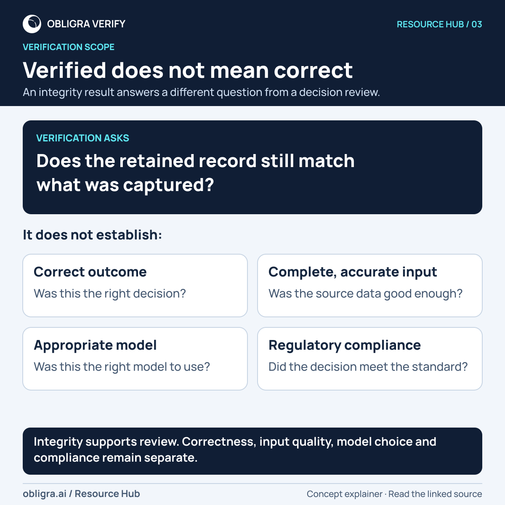
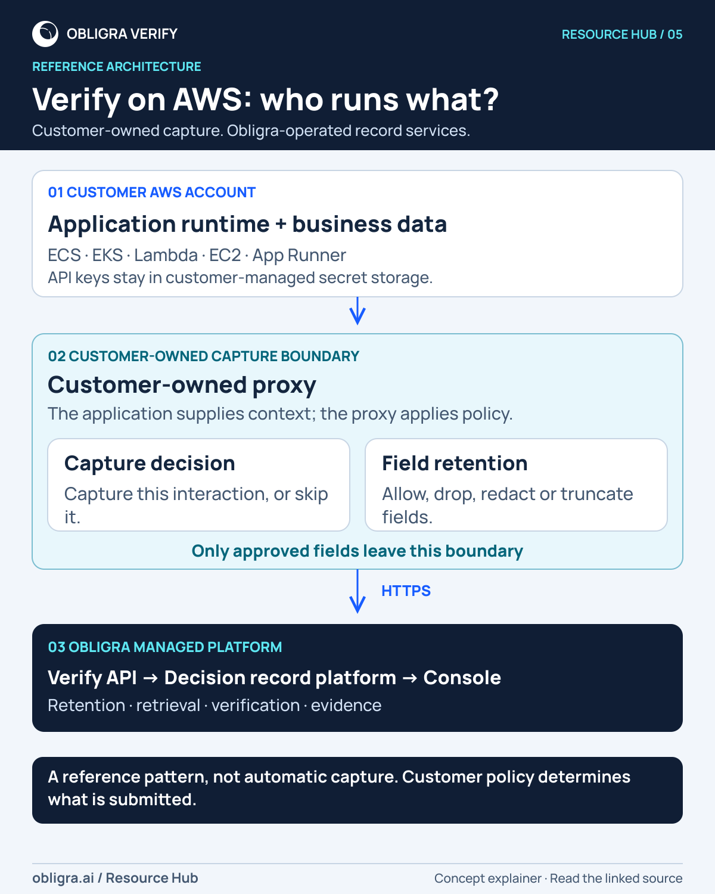
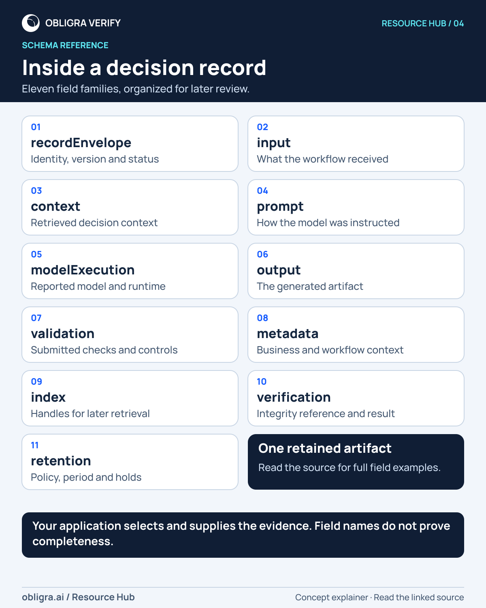

# Obligra Resource Hub: 14 polished diagrams

Finished social explainers, redesigned for readability. All PNGs are **1200 pixels wide**, in square or portrait layouts. Use the direct, immutable **PNG URLs** below for social-image attachments. SVGs are editable masters, not social upload files.

These summarize public Resource Hub concepts. Link the corresponding source page in the post. They retain the customer-supplied evidence boundary and distinguish record integrity from decision correctness.

## Download index

| # | Diagram | PNG for X / LinkedIn | SVG master | Source |
|---|---|---|---|---|
| 01 | When review starts from fragments | [PNG · 1200×1200](https://raw.githubusercontent.com/obligra/obligra-social-assets/0f275ff24e65bad780c3fcd39ca3fc93acbf75bb/approved/2026/11/resource-hub-r1/01-audit-review-without-verify-r1.png) | [SVG](https://raw.githubusercontent.com/obligra/obligra-social-assets/0f275ff24e65bad780c3fcd39ca3fc93acbf75bb/approved/2026/11/resource-hub-r1/svg/01-audit-review-without-verify-r1.svg) | [Resource Hub](https://obligra.ai/resources/audit-readiness-ai-workflows) |
| 02 | Begin with the retained record | [PNG · 1200×1200](https://raw.githubusercontent.com/obligra/obligra-social-assets/0f275ff24e65bad780c3fcd39ca3fc93acbf75bb/approved/2026/11/resource-hub-r1/02-audit-review-with-verify-r1.png) | [SVG](https://raw.githubusercontent.com/obligra/obligra-social-assets/0f275ff24e65bad780c3fcd39ca3fc93acbf75bb/approved/2026/11/resource-hub-r1/svg/02-audit-review-with-verify-r1.svg) | [Resource Hub](https://obligra.ai/resources/audit-readiness-ai-workflows) |
| 03 | Verified does not mean correct | [PNG · 1200×1200](https://raw.githubusercontent.com/obligra/obligra-social-assets/0f275ff24e65bad780c3fcd39ca3fc93acbf75bb/approved/2026/11/resource-hub-r1/03-what-verification-confirms-r1.png) | [SVG](https://raw.githubusercontent.com/obligra/obligra-social-assets/0f275ff24e65bad780c3fcd39ca3fc93acbf75bb/approved/2026/11/resource-hub-r1/svg/03-what-verification-confirms-r1.svg) | [Resource Hub](https://obligra.ai/resources/verification-lifecycle) |
| 04 | Inside a decision record | [PNG · 1200×1500](https://raw.githubusercontent.com/obligra/obligra-social-assets/0f275ff24e65bad780c3fcd39ca3fc93acbf75bb/approved/2026/11/resource-hub-r1/04-anatomy-of-a-decision-record-r1.png) | [SVG](https://raw.githubusercontent.com/obligra/obligra-social-assets/0f275ff24e65bad780c3fcd39ca3fc93acbf75bb/approved/2026/11/resource-hub-r1/svg/04-anatomy-of-a-decision-record-r1.svg) | [Resource Hub](https://obligra.ai/resources/structure-of-a-decision-record) |
| 05 | Verify on AWS: who runs what? | [PNG · 1200×1500](https://raw.githubusercontent.com/obligra/obligra-social-assets/0f275ff24e65bad780c3fcd39ca3fc93acbf75bb/approved/2026/11/resource-hub-r1/05-reference-architecture-aws-r1.png) | [SVG](https://raw.githubusercontent.com/obligra/obligra-social-assets/0f275ff24e65bad780c3fcd39ca3fc93acbf75bb/approved/2026/11/resource-hub-r1/svg/05-reference-architecture-aws-r1.svg) | [Resource Hub](https://obligra.ai/resources/reference-architecture-aws) |
| 06 | From workflow to review evidence | [PNG · 1200×1350](https://raw.githubusercontent.com/obligra/obligra-social-assets/0f275ff24e65bad780c3fcd39ca3fc93acbf75bb/approved/2026/11/resource-hub-r1/06-lifecycle-r1.png) | [SVG](https://raw.githubusercontent.com/obligra/obligra-social-assets/0f275ff24e65bad780c3fcd39ca3fc93acbf75bb/approved/2026/11/resource-hub-r1/svg/06-lifecycle-r1.svg) | [Resource Hub](https://obligra.ai/resources/what-is-verify) |
| 07 | An audit question needs evidence | [PNG · 1200×1200](https://raw.githubusercontent.com/obligra/obligra-social-assets/0f275ff24e65bad780c3fcd39ca3fc93acbf75bb/approved/2026/11/resource-hub-r1/07-auditor-questions-and-record-evidence-r1.png) | [SVG](https://raw.githubusercontent.com/obligra/obligra-social-assets/0f275ff24e65bad780c3fcd39ca3fc93acbf75bb/approved/2026/11/resource-hub-r1/svg/07-auditor-questions-and-record-evidence-r1.svg) | [Resource Hub](https://obligra.ai/resources/audit-readiness-ai-workflows) |
| 08 | The boundary is the concept | [PNG · 1200×1200](https://raw.githubusercontent.com/obligra/obligra-social-assets/0f275ff24e65bad780c3fcd39ca3fc93acbf75bb/approved/2026/11/resource-hub-r1/08-capture-boundary-vs-proxy-r1.png) | [SVG](https://raw.githubusercontent.com/obligra/obligra-social-assets/0f275ff24e65bad780c3fcd39ca3fc93acbf75bb/approved/2026/11/resource-hub-r1/svg/08-capture-boundary-vs-proxy-r1.svg) | [Resource Hub](https://obligra.ai/resources/capture-boundary-vs-proxy) |
| 09 | Three questions. Three meanings. | [PNG · 1200×1200](https://raw.githubusercontent.com/obligra/obligra-social-assets/0f275ff24e65bad780c3fcd39ca3fc93acbf75bb/approved/2026/11/resource-hub-r1/09-validation-verification-correctness-r1.png) | [SVG](https://raw.githubusercontent.com/obligra/obligra-social-assets/0f275ff24e65bad780c3fcd39ca3fc93acbf75bb/approved/2026/11/resource-hub-r1/svg/09-validation-verification-correctness-r1.svg) | [Resource Hub](https://obligra.ai/resources/verification-lifecycle) |
| 10 | Read the fields behind the question | [PNG · 1200×1350](https://raw.githubusercontent.com/obligra/obligra-social-assets/0f275ff24e65bad780c3fcd39ca3fc93acbf75bb/approved/2026/11/resource-hub-r1/10-which-fields-answer-which-review-questions-r1.png) | [SVG](https://raw.githubusercontent.com/obligra/obligra-social-assets/0f275ff24e65bad780c3fcd39ca3fc93acbf75bb/approved/2026/11/resource-hub-r1/svg/10-which-fields-answer-which-review-questions-r1.svg) | [Resource Hub](https://obligra.ai/resources/structure-of-a-decision-record) |
| 11 | Build trust one check at a time | [PNG · 1200×1350](https://raw.githubusercontent.com/obligra/obligra-social-assets/0f275ff24e65bad780c3fcd39ca3fc93acbf75bb/approved/2026/11/resource-hub-r1/11-how-trust-is-established-over-time-r1.png) | [SVG](https://raw.githubusercontent.com/obligra/obligra-social-assets/0f275ff24e65bad780c3fcd39ca3fc93acbf75bb/approved/2026/11/resource-hub-r1/svg/11-how-trust-is-established-over-time-r1.svg) | [Resource Hub](https://obligra.ai/resources/verification-lifecycle) |
| 12 | Five things a reviewer needs | [PNG · 1200×1200](https://raw.githubusercontent.com/obligra/obligra-social-assets/0f275ff24e65bad780c3fcd39ca3fc93acbf75bb/approved/2026/11/resource-hub-r1/12-what-auditors-need-r1.png) | [SVG](https://raw.githubusercontent.com/obligra/obligra-social-assets/0f275ff24e65bad780c3fcd39ca3fc93acbf75bb/approved/2026/11/resource-hub-r1/svg/12-what-auditors-need-r1.svg) | [Resource Hub](https://obligra.ai/resources/audit-readiness-ai-workflows) |
| 13 | Capture once. Review over time. | [PNG · 1200×1500](https://raw.githubusercontent.com/obligra/obligra-social-assets/0f275ff24e65bad780c3fcd39ca3fc93acbf75bb/approved/2026/11/resource-hub-r1/13-end-to-end-decision-record-lifecycle-r1.png) | [SVG](https://raw.githubusercontent.com/obligra/obligra-social-assets/0f275ff24e65bad780c3fcd39ca3fc93acbf75bb/approved/2026/11/resource-hub-r1/svg/13-end-to-end-decision-record-lifecycle-r1.svg) | [Resource Hub](https://obligra.ai/resources/reference-architecture-aws) |
| 14 | Choose runtime and governance | [PNG · 1200×1500](https://raw.githubusercontent.com/obligra/obligra-social-assets/0f275ff24e65bad780c3fcd39ca3fc93acbf75bb/approved/2026/11/resource-hub-r1/14-runtime-governance-decision-framework-r1.png) | [SVG](https://raw.githubusercontent.com/obligra/obligra-social-assets/0f275ff24e65bad780c3fcd39ca3fc93acbf75bb/approved/2026/11/resource-hub-r1/svg/14-runtime-governance-decision-framework-r1.svg) | [Resource Hub](https://obligra.ai/resources/customer-integration-patterns) |

## Use this pack

- Preserve the image’s scope note. Do not imply automatic capture, complete histories, hidden model reasoning, or proven correctness/compliance.
- The nine primary-shortlist SVGs and five supporting concept diagrams make up this 14-image release. The two quickstart onboarding visuals are not included.
- Layouts were inspected at full size and 400px display width. Primary text and flows remain readable; small source/footer text is supplementary.
- Hosting does not mean a post has been published or that a publishing platform has ingested the image. Check the actual attachment preview before posting.
- This pack does not replace or deploy changes to the Resource Hub website.

## Sources and rights

The original diagrams and official mark come from Obligra’s public website, redesigned with the owner’s authorization. Each image has a matching credits file with its source, hashes, and editorial notes. Manrope is used under the SIL Open Font License 1.1; see [Manrope-OFL.txt](Manrope-OFL.txt). No blanket license is granted over Obligra artwork or trademarks.

[Machine-readable URL index](urls.json) · [Detailed manifest and alt text](manifest.json)

## Previews

### Verified does not mean correct

### Verify on AWS: who runs what?

### Inside a decision record

